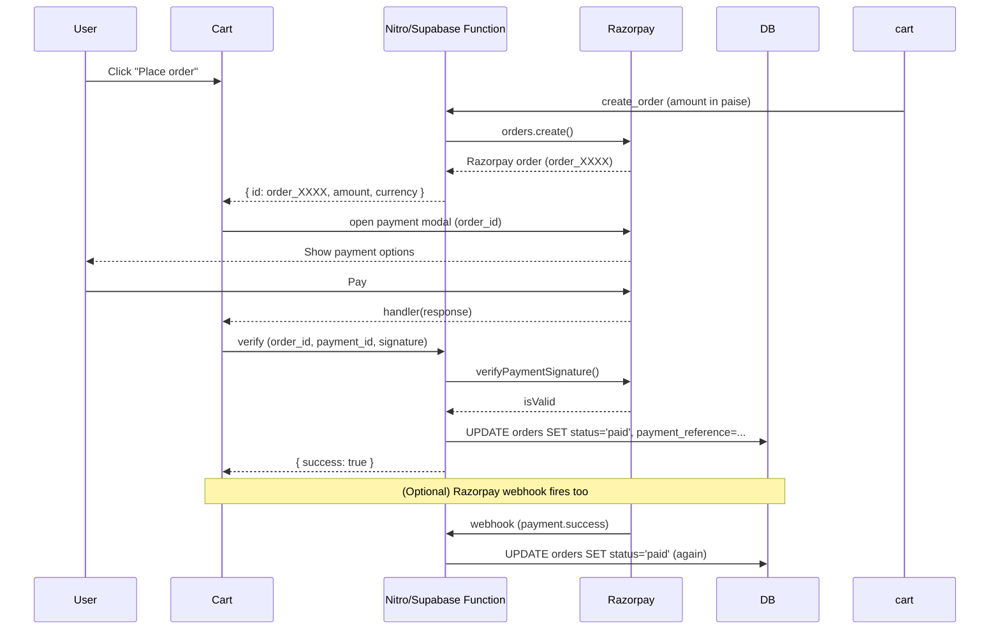

# BCUBE

This is the website I wanna build today, there is a homepage and then the product page. The custom acrylic pictures below the word products are the tabs and each tab should show each page. Then the product page should follow each steps.

This project was built with [Lovable](https://lovable.dev).

## Build with Lovable

Continue developing this project in the [Lovable editor](https://lovable.dev/projects/7ef7726e-fa1e-4a79-88cd-7cf9a6dd34b7).

- **Ship faster**: describe what you want to build and Lovable handles the code.
- **Stay in sync**: every change made in Lovable is committed straight to this repository.
- **Full ownership**: this code is yours. Push to `main` on GitHub and your changes sync back into Lovable, ready for your next prompt.

## Development

Prefer working locally? You need Node.js and npm — [install with nvm](https://github.com/nvm-sh/nvm#installing-and-updating).

```sh
git clone <this-repository-url>
cd <repository-name>
npm i
npm run dev
```

---

# 🔑 Razorpay Payment Integration

This project integrates **Razorpay** for online payments in the cart page.

---

## 1. Get your Razorpay API keys

1. Go to [Razorpay Dashboard → Developers → API Keys](https://dashboard.razorpay.com/)
2. Note your **Key ID** (`rzp_test_...`) and **Key Secret** (`rzp_test_...secret...`)
3. Copy these into your `.env` file (see §2)

> Tip: Use the **test keys** first, then switch to live keys later.

---

## 2. Environment variables

Add these to your `.env` file (create it from `.env.example` if missing):

```env
# Razorpay
RAZORPAY_KEY_ID="rzp_test_xxxxxxxxxxxx"
RAZORPAY_KEY_SECRET="xxxxxxxxxxxxxxxxxxxxx"

# Supabase
SUPABASE_URL="https://your-project.supabase.co"
SUPABASE_SERVICE_ROLE_KEY="<your-supabase-service-role-key>"
```

> `RAZORPAY_KEY_ID` and `RAZORPAY_KEY_SECRET` are used by the **server-side
> Nitro function**. The browser only needs the publishable key
> (`VITE_RAZORPAY_KEY_ID` – see §3 for cart.tsx).

---

## 3. Razorpay key in the browser (cart.tsx)

The cart page now uses the environment variable instead of a hardcoded key:

```ts
// src/routes/cart.tsx
key: import.meta.env.VITE_RAZORPAY_KEY_ID,   // <-- env var, not hardcoded
```

Make sure `VITE_RAZORPAY_KEY_ID` is set in `.env`:

```env
VITE_RAZORPAY_KEY_ID="rzp_test_xxxxxxxxxxxx"
```

---

## 4. Supabase function (`src/server/functions/razorpay.ts`)

The file `src/server/functions/razorpay.ts` exports a **Nitro serverless
function** that handles three actions:

| Action         | Purpose                                                      |
| -------------- | ------------------------------------------------------------ |
| `create_order` | Creates a Razorpay order (returns order id, amount in paise) |
| `verify`       | Verifies Razorpay payment signature (HMAC SHA256)            |
| `webhook`      | Handles Razorpay webhook events (`payment.success`)          |

### Function code

Copy-paste this function into your Nitro project (creates
`src/server/functions/razorpay.ts`):

```ts
/**
 * Razorpay Payment Functions (Nitro Serverless)
 * ... (full documentation) ...
 */
import { defineEventHandler, readBody, readRawBody, getHeader, setHeader } from "h3";
import Razorpay from "razorpay";
import { createClient } from "@supabase/supabase-js";
import { randomUUID } from "crypto";

// ─── Environment variables ───────────────────────────────────────
const RAZORPAY_KEY_ID = process.env.RAZORPAY_KEY_ID || "";
const RAZORPAY_KEY_SECRET = process.env.RAZORPAY_KEY_SECRET || "";
const SUPABASE_URL = process.env.SUPABASE_URL || "";
const SUPABASE_SERVICE_ROLE_KEY = process.env.SUPABASE_SERVICE_ROLE_KEY || "";

// ─── Helpers ─────────────────────────────────────────────────────
function getRazorpay(): Razorpay {
  return new Razorpay({ key_id: RAZORPAY_KEY_ID, key_secret: RAZORPAY_KEY_SECRET });
}

// ─── Main handler ────────────────────────────────────────────────
export default defineEventHandler(async (event) => {
  // (full code in the attached file — see the README)
});
```

> **Complete function code** is in `src/server/functions/razorpay.ts` in this
> repo. See the file for the full implementation with inline comments.

### What each action does

1. **`create_order`**
   - Calls `razorpay.orders.create()` with the amount (in **paise**, not rupees)
   - Returns `{ id, entity, amount, currency, notes, idempotency_key }`
   - The client then creates a Razorpay payment using this order ID

2. **`verify`**
   - Receives `razorpay_order_id`, `razorpay_payment_id`, `razorpay_signature`
   - Calls `razorpay.util.verifyPaymentSignature()`
   - If valid → updates the order status to `"paid"` in Supabase
   - Returns `{ ok: true, success: boolean }`

3. **`webhook`**
   - Receives the raw webhook body + `x-razorpay-signature` header
   - Calls `razorpay.util.verifySignature(rawBody, signature)`
   - On `payment.success` → updates order status to `"paid"` in Supabase
   - Returns `{ ok: true, success: boolean }`

---

## 5. Deploy to Supabase as a Remote Function

> This project uses **Nitro serverless functions** for local development.
> To deploy to Supabase as **Remote Functions** (Node.js), follow these steps:

### 5.1 Create the function in Supabase

1. Go to your [Supabase Dashboard → Functions](https://dashboard.supabase.com/functions)
2. Click **New Function**
3. Name it `razorpay`
4. Paste the code from `src/server/functions/razorpay.ts`
5. Click **Save**

### 5.2 Set environment variables in Supabase

In the dashboard:

- **Settings → Environment Variables**
- Add:
  ```
  RAZORPAY_KEY_ID=rzp_test_xxxxxxxxxxxx
  RAZORPAY_KEY_SECRET=xxxxxxxxxxxxxxxxxxxxxx
  SUPABASE_URL=https://your-project.supabase.co
  SUPABASE_SERVICE_ROLE_KEY=<your-supabase-service-role-key>
  ```

### 5.3 Configure the Razorpay webhook

In the [Razorpay Dashboard → Webhooks](https://dashboard.razorpay.com/#/webhooks):

- **URL**: `https://<your-project>.supabase.co/functions/v1/razorpay-webhook`
- **Events**:
  - `payment.success` ✓ (primary)
  - `payment.failed` (optional, for better UX)
  - `payment.captured` (optional)
- **Secret**: Use your Razorpay **Key Secret** (so the function can verify the signature)

### 5.4 Update the Supabase RLS policy (if needed)

The function uses the `service_role` key, which bypasses Row Level Security.
For production, consider:

1. Add an `razorpay_order_id` column to the `orders` table:
   ```sql
   ALTER TABLE orders ADD COLUMN razorpay_order_id TEXT;
   ```
2. Add a policy to allow authenticated users to update their own orders:
   ```sql
   CREATE POLICY "orders own update" ON orders
     FOR UPDATE USING (auth.uid() = user_id OR public.has_role(auth.uid(), 'admin'));
   ```

---

## 6. How the checkout flow works



### Frontend call sequence (cart.tsx)

1. `placeOrder()` saves the order to the `orders` table (returns `orderId`)
2. `supabase.functions.invoke("razorpay", { action: "create_order", amount })`
   → gets the Razorpay order ID
3. Razorpay SDK opens the payment modal
4. On payment success → `supabase.functions.invoke("razorpay", { action: "verify" })`
5. If `success` → show "Order placed" toast, clear the cart

---

## 7. Quick start (local)

```bash
# 1. Install the Razorpay npm package (already done)
npm install

# 2. Set env vars
cp .env.example .env
# Edit .env: add your RAZORPAY_KEY_ID / RAZORPAY_KEY_SECRET

# 3. Run dev server
npm run dev

# 4. Open http://localhost:5173/cart
```

---

## 8. Troubleshooting

| Issue                            | Fix                                                                               |
| -------------------------------- | --------------------------------------------------------------------------------- |
| `Missing RAZORPAY_KEY_ID`        | Set `RAZORPAY_KEY_ID` in `.env`                                                   |
| `Missing RAZORPAY_KEY_SECRET`    | Set `RAZORPAY_KEY_SECRET` in `.env`                                               |
| `Failed to load payment gateway` | Check that your API key ID is a test key and the browser has internet             |
| `Payment authentication failed`  | Verify the signature in the function and check the Razorpay key secret is correct |
| `Cannot find module 'razorpay'`  | Run `npm install razorpay`                                                        |

---

_This integration was added as part of the B Cube checkout flow._
